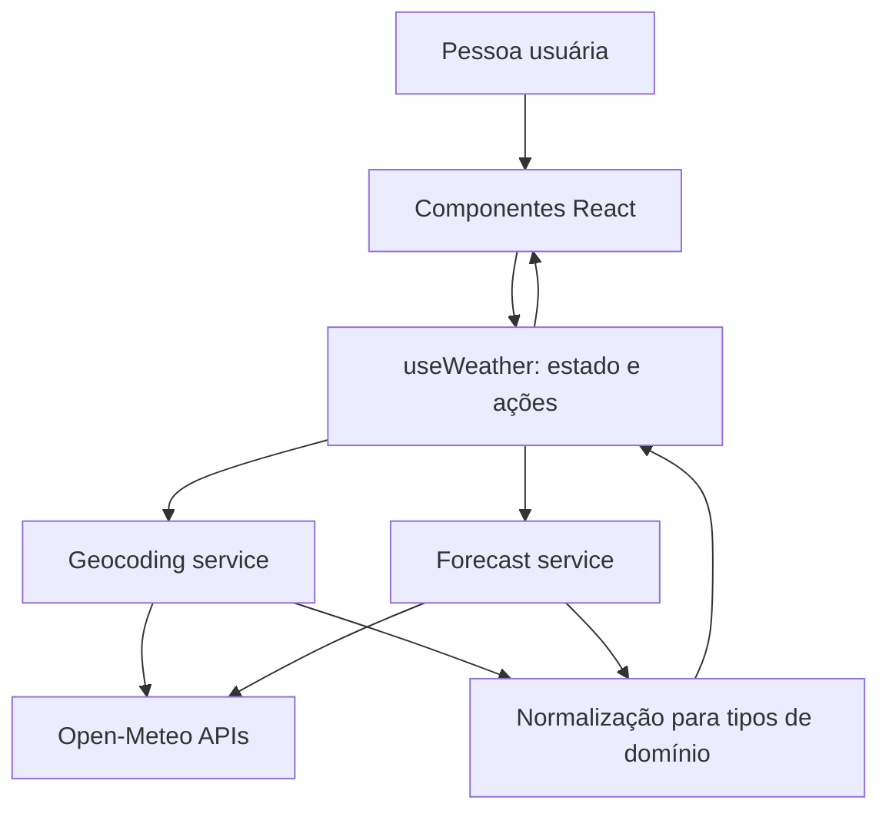

# Plano Técnico — Aplicação de previsão do tempo

## 1. Architecture Overview

Aplicação cliente React, organizada em apresentação, estado de página, domínio e integração HTTP. A UI não acessa a Open-Meteo diretamente: serviços isolam chamadas e normalizam as respostas para tipos internos.



Responsabilidades principais:

- **Apresentação:** formulário de busca, opções de cidade, controle de unidade, clima atual, previsão e mensagens de estado.
- **Estado da página:** coordenar busca, seleção de cidade, consulta da previsão, unidade e ações de nova tentativa.
- **Serviços:** construir requisições HTTP, validar respostas e converter os formatos externos em dados de domínio.
- **Domínio:** tipos compartilhados, formatação/conversão de temperatura e mapeamento de códigos de condição climática.

## 2. Tech Stack

| Área | Tecnologia | Justificativa |
| --- | --- | --- |
| UI | React 19 + React DOM | Stack definida pelo projeto e adequada a uma interface interativa de página única. |
| Build e desenvolvimento | Vite 8 | Ferramenta já configurada no repositório, com servidor local e build de produção. |
| Linguagem | TypeScript strict | Tipagem dos contratos normalizados e redução de erros entre API, estado e UI. |
| Estilos | Tailwind CSS 3 | Stack existente; permite implementar layout responsivo com utilitários já configurados. |
| Dados externos | Open-Meteo Geocoding e Forecast | Fonte definida pelo projeto, sem chave de API. |
| Testes unitários e de UI | Vitest, Testing Library, user-event e jsdom | Dependências já presentes; permitem testar funções e interações sem navegador real. |
| Testes E2E | Playwright | Dependência e configuração já presentes para validar fluxos em navegador e viewport mobile. |
| Qualidade | Biome | Lint e formatação definidos pelo projeto. |

Não adicionar biblioteca de estado ou de requisições inicialmente: o fluxo é local e limitado a uma página. Reavaliar apenas se o escopo passar a exigir cache compartilhado, atualizações em segundo plano ou múltiplas rotas.

## 3. Project Structure

A estrutura abaixo é proposta; o scaffold atual ainda não contém `src/` ou `tests/`.

```text
src/
  components/
    CitySearch.tsx        # Campo de busca e resultados selecionáveis
    UnitToggle.tsx        # Seleção Celsius/Fahrenheit
    CurrentWeather.tsx    # Condição atual e temperatura
    ForecastList.tsx      # Previsão diária
    WeatherStatus.tsx     # Loading, erro e vazio
  hooks/
    useWeather.ts         # Estado e orquestração do fluxo da página
  services/
    openMeteo.ts          # HTTP, validação e normalização da API
  types/
    weather.ts            # Tipos do domínio e estados de consulta
  utils/
    temperature.ts        # Conversão e formatação de temperaturas
    weatherCode.ts        # Mapeamento de códigos WMO para condição e ícone
  App.tsx
  main.tsx
tests/
  ...                     # Testes unitários, de componentes e E2E
```

Manter um componente por arquivo e lógica de acesso a dados em `services/`, conforme as convenções do projeto. Evitar abstrações genéricas sem necessidade para este fluxo.

## 4. Data Model

Tipos de domínio sugeridos. Os tipos crus da API devem permanecer internos ao serviço e não ser usados diretamente pelos componentes.

```ts
type TemperatureUnit = 'celsius' | 'fahrenheit';

interface City {
  id: number;
  name: string;
  region?: string;
  country?: string;
  latitude: number;
  longitude: number;
  timezone?: string;
}

interface WeatherCondition {
  code: number;
  description: string;
}

interface CurrentWeather {
  temperatureCelsius: number;
  condition: WeatherCondition;
  observedAt?: string;
}

interface ForecastDay {
  date: string;
  minimumCelsius?: number;
  maximumCelsius?: number;
  condition: WeatherCondition;
}

interface WeatherData {
  city: City;
  current: CurrentWeather;
  forecast: ForecastDay[];
}
```

Temperaturas ficam normalizadas em Celsius no domínio; a conversão para exibição em Fahrenheit é feita por função pura. Isso mantém uma única fonte de verdade e evita nova consulta ao alternar a unidade. Campos opcionais refletem respostas parciais da fonte. A decisão sobre quais extremos diários exibir permanece em aberto na spec.

Estados assíncronos devem distinguir carregamento, sucesso, vazio e erro. Busca e previsão têm estados separados para que falha de uma operação não seja confundida com a outra.

## 5. Data Flow

1. A pessoa digita um nome e submete a busca.
2. `useWeather` marca a busca como carregando e chama `searchCities` no serviço.
3. O serviço consulta Geocoding, valida a resposta e normaliza opções em `City[]`.
4. A UI mostra resultados com contexto geográfico disponível; sem resultados, apresenta estado vazio.
5. Ao selecionar uma cidade, `useWeather` registra a seleção e chama `getWeather` com coordenadas.
6. O serviço consulta Forecast, transforma os dados atual e diário em `WeatherData` e devolve uma resposta normalizada.
7. Os componentes renderizam clima atual e cinco datas de previsão. A unidade escolhida é aplicada somente na formatação dos valores.
8. Em falha, o estado de previsão mantém a cidade visível, apresenta uma mensagem e oferece nova tentativa para a cidade selecionada.

Requisições anteriores devem ser canceladas ou ignoradas quando uma nova busca/seleção as substituir, evitando que respostas lentas atualizem a tela com dados de outra cidade.

## 6. External APIs

### Geocoding

- **Endpoint:** `https://geocoding-api.open-meteo.com/v1/search`
- **Parâmetros previstos:** `name` com o texto pesquisado, `count` limitado para evitar uma lista extensa, `language=pt` para resultados localizados e `format=json`.
- **Campos usados:** identificador, nome, região administrativa, país, latitude, longitude e fuso horário quando disponíveis.

### Forecast

- **Endpoint:** `https://api.open-meteo.com/v1/forecast`
- **Parâmetros previstos:** `latitude`, `longitude`, `current=temperature_2m,weather_code`, `daily=weather_code,temperature_2m_min,temperature_2m_max`, `timezone=auto` e `forecast_days` conforme decisão sobre o período de cinco dias.
- **Unidade:** solicitar temperaturas na unidade padrão Celsius e converter localmente para Fahrenheit quando selecionado.
- **Campos usados:** temperatura atual, código WMO, datas locais e temperaturas mínimas/máximas diárias quando fornecidas.
- **Mapeamento:** interpretar `weather_code` usando tabela WMO centralizada; não inferir a condição pelo valor da temperatura.

### Observações da integração

- Tratar status HTTP não bem-sucedido, timeout, JSON inválido e campos ausentes como erros controlados do serviço.
- Não depender de endpoint com chave privada; o projeto definiu uso público da Open-Meteo sem chave.
- Confirmar termos, cobertura, limites de uso e precisão dos dados da API antes da publicação.

## 7. State Management

Manter o estado na página, encapsulado em `useWeather`, usando estado React local. Não há necessidade atual de contexto global ou persistência.

Estado proposto:

- `query`: texto corrente da busca.
- `searchState`: idle, loading, results, empty ou error, incluindo resultados e mensagem conforme aplicável.
- `selectedCity`: cidade escolhida ou `null`.
- `weatherState`: idle, loading, success ou error, incluindo `WeatherData` ou mensagem conforme aplicável.
- `unit`: `celsius` ou `fahrenheit`.

A unidade inicial e sua persistência são decisões em aberto; usar Celsius como padrão técnico provisório até confirmação. Não persistir cidade/unidade em armazenamento local na primeira versão, pois isso não foi definido como requisito.

## 8. Error Handling Strategy

- **Busca em andamento:** mostrar indicador/status acessível e impedir submissões duplicadas enquanto a mesma busca está ativa.
- **Busca vazia:** distinguir entrada em branco, que não deve chamar a API, de resposta sem resultados, que deve oferecer nova consulta.
- **Erro de busca:** mensagem curta, resultados anteriores não devem ser apresentados como correspondências da consulta atual, e oferecer nova tentativa.
- **Previsão em andamento:** mostrar estado junto à cidade selecionada.
- **Erro de previsão:** informar que os dados não puderam ser carregados e oferecer nova tentativa. Não apresentar dados antigos como atuais sem indicar claramente sua referência temporal.
- **Resposta parcial:** renderizar apenas campos disponíveis sem quebrar a página; a ausência dos campos mínimos deve produzir estado de erro controlado.
- **Timeout/rede:** converter exceções técnicas em mensagem compreensível; manter detalhes técnicos fora da interface.
- **Corrida entre requisições:** cancelar ou descartar respostas obsoletas após mudança de busca ou cidade.

Cache e funcionamento offline ficam fora do escopo atual; se forem solicitados, definir validade e indicação visual de dados possivelmente desatualizados.

## 9. Testing Strategy

### Unitários — Vitest

- Testar conversão Celsius/Fahrenheit, arredondamento/formatação e identificação da unidade.
- Testar mapeamento dos principais códigos WMO e comportamento para código desconhecido.
- Testar normalização de resultados de geocoding, inclusive região/país ausentes e resposta sem resultados.
- Testar normalização de forecast, associação correta entre datas e valores, dados incompletos e respostas inválidas.
- Mockar `fetch` para sucesso, erro HTTP, JSON inválido, timeout e falha de rede.

### Componentes e integração — Testing Library

- Buscar e selecionar uma cidade, incluindo múltiplos resultados homônimos.
- Verificar estados de loading, vazio e erro, além da ação de tentar novamente.
- Verificar exibição de clima atual e cinco dias de previsão.
- Alternar unidades e confirmar que todos os valores e rótulos mudam sem alterar a cidade ou as datas.
- Verificar rótulos acessíveis e operação dos controles por teclado.

### E2E — Playwright

- Fluxo feliz de busca, seleção, consulta e alternância de unidade.
- Fluxos de busca sem resultados e falha na consulta com tentativa novamente.
- Validar fluxo principal em viewport mobile e desktop, observando sobreposição e rolagem horizontal.
- Interceptar respostas da Open-Meteo para manter os testes determinísticos; reservar chamadas reais para verificação manual ou smoke test não bloqueante.

### Gates do repositório

Após a implementação em `src/` ou `tests/`, executar `pnpm lint`, `pnpm build` e `pnpm test`. O E2E pode ser executado com `pnpm test:e2e` quando o fluxo estiver implementado e o ambiente Playwright estiver disponível.

## 10. Risks & Trade-offs

| Risco ou decisão | Consequência | Tratamento no plano |
| --- | --- | --- |
| Inclusão do dia atual nos cinco dias ainda não foi decidida. | Afeta número de dias solicitados, datas mostradas e critérios de teste. | Usar `timezone=auto`; confirmar semântica antes de fechar `forecast_days` e os testes. |
| Campos meteorológicos adicionais não foram aprovados. | Pode expandir layout e o contrato de dados. | Manter os dados mínimos da spec; incluir mínimas/máximas apenas quando validadas como parte do escopo. |
| Códigos WMO precisam de descrição amigável e localização. | Código numérico isolado não atende à descrição de condição exigida pela UI. | Centralizar mapeamento WMO e testar códigos conhecidos e desconhecidos. |
| Resposta de API pode ser parcial ou mudar. | Pode gerar apresentação enganosa ou falhas em runtime. | Validar e normalizar na fronteira do serviço; manter campos não essenciais opcionais. |
| Conversão local simplifica a alternância, mas exige cuidado com precisão e formatação. | Valores arredondados podem divergir de conversões exibidas pela própria API. | Manter Celsius como unidade canônica e definir arredondamento/formato numérico antes da implementação. |
| Sem biblioteca de cache, mudanças de cidade podem refazer consultas. | Simplicidade maior, com possível requisição repetida. | Aceitar para a primeira versão; adicionar cache somente se houver requisito mensurável. |

### Decisões pendentes para fechar antes da implementação

- Se os cinco dias incluem hoje e como aplicar o fuso local da cidade.
- Quais campos diários são obrigatórios (por exemplo, mínima/máxima) e como tratar ausência de condição ou temperatura.
- Unidade inicial, preferência persistente ou não e convenção de arredondamento.
- Idioma e formatos de data/hora da interface.
- Metas de desempenho, navegadores mínimos e nível de conformidade de acessibilidade.